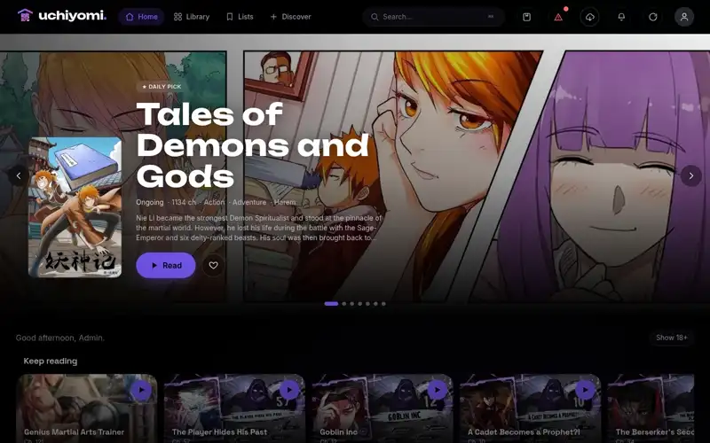
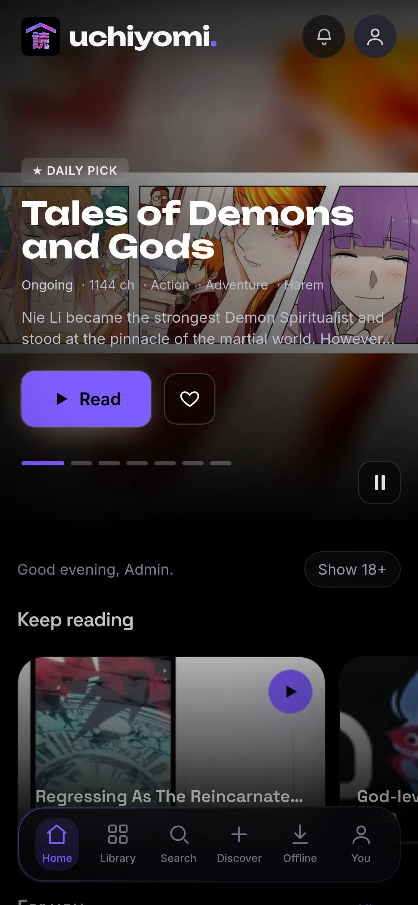
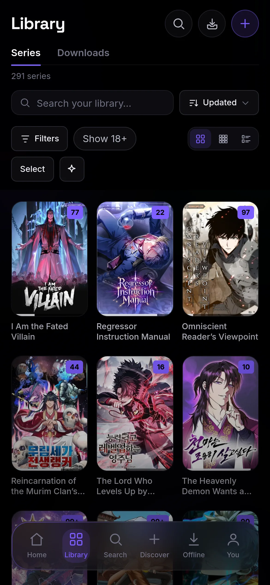

# Uchiyomi

*Self-hosted manga server that downloads too: a free, open-source manga, manhwa and webtoon reader and downloader
that keeps up with new chapters on its own.*

[](https://github.com/AngeloSha/uchiyomi/actions/workflows/ci.yml)
[](https://github.com/AngeloSha/uchiyomi/releases/latest)
[](LICENSE)
[](https://github.com/AngeloSha?tab=packages&repo_name=uchiyomi)

### 🌐 [**uchiyomi.com**](https://uchiyomi.com) · 🐙 [GitHub](https://github.com/AngeloSha/uchiyomi) · ☕ [Ko-fi](https://ko-fi.com/angeloshaheen) · 📜 [Changelog](CHANGELOG.md)

A **self-hosted manga server** for your own hardware. It serves your library the way Komga or Kavita do,
**downloads and watches for new chapters** the way Mihon does, and puts a webtoon-first **manga reader** in front
of both that installs as an app on any phone, tablet or computer. Free and open source, in one Docker Compose file.

[](https://uchiyomi.com)

<p align="center">
  
  
  
</p>

## Why Uchiyomi

- **A library server and a manga downloader in one.** It reads the CBZ, CBR, PDF and image EPUB files you already own,
  and it follows series and downloads new chapters from Mihon / Tachiyomi extensions, MangaDex or a site you paste.
  No stack of five tools to wire together.
- **A reader built for webtoons.** Continuous scroll that runs straight into the next chapter, wide pages split,
  borders cropped, tap zones and a game controller. It installs as an app on iPhone, iPad and Android and reads
  offline, and your favourites' next chapters download to the phone by themselves.
- **It repairs itself.** Health finds chapter gaps, short chapters, bad downloads and failing sources, and names
  the step a source fails at; **Fix everything** works through them, once or every night. A second Cloudflare
  solver can take over when the first one fails.
- **It picks your translation.** Prefer or block scanlation groups, wait a day or two for your group, and swap in
  its release when it arrives.
- **It knows when chapters are due.** The release radar estimates each series' next chapter, and smart update
  checks ask quiet series less often: about half the requests a day on the library they were tested on.
- **It reads where you read.** The browser, the installed app, a Windows and Mac app, Mihon (with its own extension,
  or Mihon's Komga extension and tracker), OPDS readers such as KOReader and Panels, and a Homepage dashboard tile.
- **It is built for a household.** Accounts with their own progress, libraries and age limits, an 18+ library
  that stays hidden until someone asks for it, smart and shared lists, 2FA and single sign-on.
- **It is safe to try beside Komga or Kavita.** Unless you give it the library's owner (`PUID`/`PGID`), it cannot
  write to your files at all, and what it downloads goes to its own folder.

### How it compares

| | Uchiyomi | Komga | Kavita | Suwayomi | Mihon |
| --- | :---: | :---: | :---: | :---: | :---: |
| Fetches new chapters by itself | ✅ | ❌ | ❌ | ✅ | ✅ |
| A server for several people, each with their own progress | ✅ | ✅ | ✅ | ◐ preview builds | ❌ |
| Installs as an app and reads offline | ✅ | ◐ no offline | ◐ no offline | ◐ no offline | ◐ Android only |
| Scrolls straight on into the next chapter | ✅ | ❌ | ◐ replaces the strip | ✅ | ✅ |
| Prefers or blocks scanlation groups | ✅ | – | – | ◐ per series | ◐ per series |
| Two-factor sign-in | ✅ | ❌ | ❌ | ❌ | – |
| Reads text ebooks (reflowable EPUB) | ❌ | ✅ | ✅ | ❌ | ❌ |
| Kobo or KOReader progress sync | ❌ | ✅ | ◐ KOReader only | ◐ KOReader only | ❌ |

<sub>Checked 2026-10-14 against Uchiyomi v0.61.2, Komga 1.29.0, Kavita 0.9.1.4, Suwayomi v2.4.2366 and Mihon 0.21.2.
◐ partly · – doesn't apply. All 26 rows, what each ◐ means and the sources are in
[docs/COMPARISON.md](docs/COMPARISON.md); [uchiyomi.com/vs](https://uchiyomi.com/vs) adds a paragraph on each project.</sub>

**If you already run Sonarr for TV and Radarr for films**, this is the same idea for manga, except the reader is
included: the indexer, the scheduler, the downloader, the Cloudflare solver and the media server come in one compose
file instead of five tools. The whole mapping is in the [comparison](docs/COMPARISON.md#against-a-do-it-yourself-stack): an
*\*arr stack for manga*, without the stack.

**It fetches by two routes**, and both ship in the default install. **Mihon / Tachiyomi extensions**: you point
Uchiyomi at an extension repository you trust ([how](docs/extensions.md#add-an-extension-repository--step-by-step)),
and from then on its extensions are browsable in the admin panel, installable with one click and searchable
immediately, run by a bundled engine (Suwayomi-Server, headless: you never open it) that starts with the stack and is
optional; MangaDex and sites you add by URL work without it. And **generic engines** for the common manga-site
families, where you paste a site's URL yourself. Plus **MangaDex**, via its official public API.

Uchiyomi hosts no sources, ships no extensions and compiles nothing into the image; no source is enabled
until you choose one. You pick what to enable, and you are responsible for using it in line with those
sites' terms and your local law.

> 📖 **[Full usage guide →](docs/USAGE.md)**: every screen walked through with screenshots (library, reader,
> Discover, admin, security, offline).

## Features

**Reading**

- **Webtoon-first reader** — continuous vertical scroll that runs straight into the next chapter, or paged, RTL and
  double-page spreads, with the mode picked for each series from its pages. A spread a source cut into two pages can be
  joined back into one (or merged and split by hand, for you alone), wide spreads split or turned on a phone, borders cropped, an e-ink, grayscale or inverted
  filter, tap zones, rebindable keys and a game controller, a narrower column for a wide screen and pages fetched at
  your screen's size, each set per device. A refresh reopens the chapter you are reading, and moving on says which
  chapters the series is missing.
- **Skips the pages that are not the story** — the scanlator credit page that opens every chapter is found
  by repetition and collapsed into a band you can tap open (or hide entirely, or show everything).
- **Translated pages (opt-in)** — read a raw chapter in your own language: the server reads each speech bubble, translates
  the page with the lines before and the series' names, and writes it back into the bubble. Runs on your server, as an
  optional download; nothing changes until an admin turns it on.
- **True-black OLED interface**, or a softer *Graphite* or *Midnight* if you prefer, built for a phone and installable
  as a PWA.
- **Offline downloads** — save chapters to the device and read them with no connection at all; with *Keep favorites
  offline* on, your favourites' next unread chapters download to the phone by themselves.
- **A Home that knows what to read next** — *Keep reading*, *Pick back up* for the series you stopped part-way months
  ago, *Hidden gems* (well rated on AniList, read by nobody in the house) and *Because you read*, in the order you
  choose: **Customize** moves its rails and hides the ones you don't use.
- **Moments** — star a page and it lands on its own screen as the panel itself, with notes.
- **Reading Studio & Wrapped** — a year heat-map (or all time, scrolling back to your first read), chapters by month
  and weekday, your top series and genres, and how long you read: hours, minutes a chapter, by hour of the day and by
  device. **Insights** adds when you would finish what you are reading, your best day and week, this month's genre
  mix, the series you dropped and your backlog; badges say what they take, and each unlocks a frame for your avatar.
- **Release radar** — when each series' next chapter is likely, said as an estimate (*~Friday*, *usually Fridays*,
  *running late*), with an *Expected this week* list and a *Releasing soon* order.
- **Incognito reading** — keep your place without leaving history, stats or tracker updates, on every device.

**Your library**

- **Files you already own** — CBZ, CBR, PDF, image EPUB or a folder of images, in any folder layout.
- **A Library you can find things in** — search it by title or author, one **Sort** menu where every order runs
  both ways (newest, recently read, most popular and top rated on AniList, your own stars, most chapters, A–Z),
  **Comfortable, Compact or List**, covers that show how far you are, and filters (read state, status, source,
  format, genres) in rows that fold. Tap an author on a series page to see everything of theirs you have.
- **Library management** — several libraries, each over as many folders as you like, *Select all* with bulk
  fetch and removal, editable metadata that survives a rescan, merge (each chapter kept once), delete, restore
  and forget, and *Rescan everything* for files changed behind its back. Optionally, a series with no description,
  genres or author gets them filled in overnight from AniList or another of its sources, never over its own.
- **Banners made from the series itself** — a series with no banner on AniList gets one built from striking panels of
  its own pages.
- **Language editions** — the same series in English and in Spanish is one card, with chips to switch between
  them on the series page and in the reader; each language keeps its own chapters, folder and progress.
- **Your stars beside AniList's score** — one panel on the series page, the Library sorts by either, and Home
  has *Most popular* and *Hidden gems* rails.
- **Related works** — sequels, side stories and spin-offs from AniList on each series page, *Next in the story*
  at the end of the reader, and recommendations you already own first in *More like this*.
- **Smart and shared lists** — save any Library view as a live list, share a list with the household (view
  only), and show lists on Home and in OPDS readers.
- **Health** — finds chapter gaps, suspiciously short chapters, bad downloads and chapter files that cannot be read,
  duplicates and failing sources, a downloads disk too full to download or a share that is not mounted, and members'
  tracker sign-ins that need renewing, and names the step a source fails at. Read it card by card or series by
  series. **Fix everything** works through every card by itself, once or every
  night, and then says what only you can decide. Every fix says what it does before you press it, shows its
  progress live, and keeps what it did; *Verify chapter files* re-checks that what the database claims is on
  disk actually is. When something needs you, **Admin** in the sidebar turns amber or red, so you don't have to look.
- **Notice chapters** — the hiatus and announcement posts some sites number as chapters (*100.5*) can be hidden,
  per series type, from lists, counts, downloads and Mihon.
- **Delete read chapters** — optional: chapters it downloaded and everyone has finished go after a wait you choose,
  stay listed with everyone's history, and are never fetched back by themselves.
- **Import what you already track** — a Mihon backup, a MangaDex list, a pasted list of titles, or your
  AniList / MyAnimeList / Kitsu list. Every match is **reviewed before it lands**, with a confidence score,
  *Change* and *Skip*, and batches you can resume.

**Fetching**

- **Mihon / Tachiyomi extensions**, the whole catalogue of a repository you add, plus generic engines for common
  site families (paste a URL) and MangaDex. Nothing is enabled until you choose it, and each extension's own settings
  are one click away, as in Mihon. A site that wants you signed in opens in the engine's own browser (**Open site**,
  Mihon's *Open in WebView*), and the sign-in is kept.
- **Discover** — what your sources just published, **one card per series** with each source's icon, leaving
  out what you already own, from every source at once; and a search that **answers progressively**: results
  appear as each source replies instead of waiting for the slowest, and every source says whether it answered,
  failed or timed out. Picks for you (*Recommended for you* and *Because you read*) get a band of their own, the top
  pick big with its art glowing behind it; they and the trending manhwa, manga and manhua rows, with their Top 10, sit
  inside the wall, and any chapter can be **read before you add the series**.
- **Follows a series on more than one source** (three besides its main one, or up to ten if you allow it), and when a
  chapter will not come down it tries the other copies, then other sources, before giving up. When a site dies for good, *Find other sources* and **Replace
  a source** move its series to sources that work, after you have looked at each match.
- **Chooses the translation** — prefer or block scanlation groups, server-wide or per series; wait a couple
  of days for a preferred group, and, if you switch it on, **upgrade** to its release when it turns up after another
  group's; see every
  version of a chapter and fetch a specific one. The group is written into the file as ComicInfo `<Translator>`.
- **Shows you what you do not have** — chapters the sources list but your disk lacks appear as grey rows you
  can select and fetch.
- **Library → Downloads** — everything the server is fetching, whoever started it, as covers that fill like apps
  being installed, with what came in today; a ring on the Library tab says when something is coming in.
- **A slow archive** — a whole back catalogue fetched a chapter at a time over nights or days, with the random
  pauses of someone reading, so a site never sees a burst; it survives restarts and never counts as new chapters.
- **Numbers webtoon posts in the order they were posted** — a source that gives many different posts one chapter
  number (an episode split into parts) no longer reads as a few chapters with dozens of versions.
- **Survives real-world sources** — it slows down when a site rate-limits instead of hammering it, a
  chapter missing a handful of pages is kept as a **partial**, with placeholders, and repaired overnight
  rather than thrown away, and a second site that splits a chapter differently is recognised instead of
  downloaded twice.
- **Sources that explain themselves** — each one is checked step by step (search, chapter list, page list,
  images), *Test all* checks them at once, and a site that says it is offline is told apart from a broken one.
- **A backup Cloudflare solver** — FlareSolverr, Byparr or trawl; a second solver takes a site over when the first
  one fails, and a busy solver is never mistaken for a broken site.
- **Smart update checks** (opt-in) — series that have been quiet for a long time are asked less often, at least
  every three days, and a series whose next chapter is due is asked as usual.

**Household**

- **Multi-user** — accounts, per-user progress and favourites, streaks and a leaderboard.
- **Chapter comments** — react to a chapter with one tap or say something about it, right where the chapter ends in
  the reader, and see which chapters the household talked about on the series page. Only members who can open the
  series see it, and anyone can switch it off for themselves.
- **Age ratings and an 18+ library** that stays off the home screen, the grid and search until somebody asks
  for it, with a per-member rating cap, a whole source rated *Adult only* when its extension does not say so, and a
  per-member permission to add series at all.
- **Security** — 2FA, lockout, active sessions, an audit log, and **OIDC single sign-on** against Authentik,
  Authelia or Keycloak.
- **Scoped API tokens** — read, write or admin, revocable, with an opt-in for 18+ libraries.
- **Automatic nightly backups** of the database and config, restorable, at an hour you pick: keep 1 to 365 of
  them, or switch the nightly off if you back up another way.

**Beyond the browser**

- **Push notifications** when a followed series gets a new chapter or someone adds to a chapter's comments you are in,
  and one digest per library update to a
  **webhook, Home Assistant, ntfy or Discord**.
- **OPDS** — read from Panels, Chunky or KOReader, page by page over OPDS-PSE.
- **A Mihon / Tachimanga extension** — read your library from Mihon, any Tachiyomi fork, Tachimanga (iOS)
  or Suwayomi with one API token: [uchiyomi-extension](https://github.com/AngeloSha/uchiyomi-extension).
- **A Komga-compatible API** — point Mihon's own Komga extension at Uchiyomi instead and its built-in Komga
  tracker syncs reading progress back in both directions, forward-only: [how to set it up](docs/extensions.md#komga-compatible-api).
- **Progress sync** to AniList, MyAnimeList, Kitsu and MangaUpdates: the highest chapter you finished, never
  backwards, and *Completed* only once the series has ended.
- **A Homepage dashboard tile** — [Homepage](https://gethomepage.dev)'s own Komga widget shows your libraries,
  series and chapters with a read token ([how](docs/USAGE.md#on-a-dashboard-homepage)).
- **Nine languages**, with right-to-left layout for Arabic.
- **A Windows and macOS app (beta)** — the whole thing as a program on your own computer, with the library in a
  folder there and no server to run, still checking for new chapters from the tray or menu bar when its window is
  closed; or, if you already run a server, a window onto it: [download the desktop app](#download-the-desktop-app).

**Nothing phones home.** An update check reads GitHub's public releases page and sends nothing about your
server; it can be turned off. An anonymous install count exists and is **off unless you turn it on**, and
the settings page shows you the exact object it would send before you agree to it — a monthly-rotating id,
the version, the CPU architecture and which deployment shape you run. No library, no titles, no accounts,
no address. [What leaves your server](docs/CONFIGURATION.md#what-leaves-your-server).

> 📖 Every screen walked through with screenshots: **[docs/USAGE.md](docs/USAGE.md)**

## Install

**Requirements:** Docker and Docker Compose, plus a manga library on disk. Any folder layout works — a
directory counts as a series when it directly contains chapters, at whatever depth.

> **Don't clone the repo to install it.** The top-level `docker-compose.yml` builds from source and is the
> *development* stack. The two commands below are the whole install.

```bash
curl -O https://raw.githubusercontent.com/AngeloSha/uchiyomi/main/deploy/docker-compose.yml
docker compose up -d
```

Open **http://localhost:8080** and create your admin account in the browser. Nothing to generate, no config
file to edit. That starts the app (with Postgres inside it), a Cloudflare solver and the optional extension engine,
from multi-arch images (amd64 + arm64) that run on a NAS or a Raspberry Pi. On a small board, mind the memory: the
Cloudflare solver idles at about 850 MB and the extension engine is capped at 2 GB; `EXTENSION_ENGINE=0` in
`.env` leaves the engine out.

> 📦 CasaOS, Unraid, Umbrel, an external database, reverse proxies and updating:
> **[docs/INSTALL.md](docs/INSTALL.md)**

Rather not run a server at all? The desktop app below is the same Uchiyomi on your own Windows PC or Mac.

## Download the desktop app

**Uchiyomi Desktop (beta)** for Windows and Mac. On first launch it asks how you want to use it: **on this
computer** (the whole app, with the library in a folder on your PC and no Docker, server or account) or
**connected to your server** (a window onto the Uchiyomi you already run).

| Your computer | Download (always the newest version) |
|---|---|
| Windows (x64) | [Uchiyomi-Setup.exe](https://github.com/AngeloSha/uchiyomi/releases/latest/download/Uchiyomi-Setup.exe) |
| Mac with Apple silicon (M1 or newer) | [Uchiyomi-mac-arm64.dmg](https://github.com/AngeloSha/uchiyomi/releases/latest/download/Uchiyomi-mac-arm64.dmg) |
| Mac with an Intel processor | [Uchiyomi-mac-x64.dmg](https://github.com/AngeloSha/uchiyomi/releases/latest/download/Uchiyomi-mac-x64.dmg) |

- **Windows:** run it; it installs for your account with no administrator prompt. The first time, choose
  **More info** → **Run anyway** on *"Windows protected your PC"* (the app is not signed yet).
- **Mac:** drag Uchiyomi to Applications. The first time, macOS refuses to open it; choose **Open Anyway** in
  **System Settings → Privacy & Security**. Not sure which Mac? Apple menu → *About This Mac*: **Chip** means
  Apple silicon, **Processor** means Intel.

Everything else — step by step with pictures, the two modes, adding sources, updates, backups, where files live,
uninstalling — is in **[the desktop guide](docs/DESKTOP.md)**. No Linux or Windows on Arm build; use Docker there.

## Documentation

| | |
|---|---|
| [Usage](docs/USAGE.md) | Every screen, with screenshots |
| [Install](docs/INSTALL.md) | One-click stores, updating, HTTPS, external DB |
| [Desktop app](docs/DESKTOP.md) | Uchiyomi Desktop for Windows and macOS (beta): on your computer, or a window onto your server |
| [Configuration](docs/CONFIGURATION.md) | Environment variables and source paths |
| [Extensions](docs/extensions.md) | Adding an extension repository, step by step; the Mihon / Tachiyomi engine |
| [API](docs/api.md) | REST reference |
| [Migrating](docs/MIGRATING.md) | Moving between layouts and versions |
| [Comparison](docs/COMPARISON.md) | Komga, Kavita, Suwayomi and Mihon, row by row, dated and sourced |

## Translations

The interface ships in **English, Spanish, French, German, Portuguese (Brazil), Russian, Japanese, Chinese
and Arabic**, with right-to-left layout for Arabic. Pick one under **Profile → Settings → General → Language**; the choice
follows your account to other devices.

**Everything except English is machine-assisted and has not been checked by a native speaker.** If something
reads wrong, it is one JSON file per language in [`web/public/locales/`](web/public/locales) and the keys are
the English source strings — edit a value, open a pull request, done. A missing key falls back to English
rather than showing a blank or a placeholder, so a partial translation is always safe to ship.

Adding a language: copy `en` semantics into `web/public/locales/<code>.json`, add the code to `LOCALES` in
`web/lib/i18n.ts`, and set `dir` if it is right-to-left.

## Roadmap

Actively developed. On deck:

- 🧭 **Per-source genre browsing** — browsing one source's newest and popular titles already works; genres
  are the part still missing.
- 📱 **Native App Store and Play builds** — the PWA installs on both today; wrapping it properly is planned.

Everything already shipped is in the **[changelog](CHANGELOG.md)**.

## Support

Uchiyomi is free and open-source. If it's useful to you, you can help fund continued development:

**[☕ Buy me a coffee on Ko-fi →](https://ko-fi.com/angeloshaheen)**

You'll also find a **♡ Sponsor** button at the top of this repo's GitHub page, and a **Support Uchiyomi** link inside
the app on the **Profile** rail.

Thank you to everyone who supports Uchiyomi on Ko-fi: ☕ **Samukka** · ☕ **Allurise**

## Contributors

Uchiyomi is built and maintained by [@AngeloSha](https://github.com/AngeloSha). Pull requests, bug reports, and
feature ideas are all welcome: start with [CONTRIBUTING.md](CONTRIBUTING.md), or open an
[issue](https://github.com/AngeloSha/uchiyomi/issues).

- 💬 **[Discussions](https://github.com/AngeloSha/uchiyomi/discussions)** — questions, ideas, and what you've built with it
- 📜 **[Releases](https://github.com/AngeloSha/uchiyomi/releases)** / **[Changelog](CHANGELOG.md)** — watch the repo to hear about new ones
- 🔒 **[Security policy](SECURITY.md)** — please report vulnerabilities privately

Thanks to everyone who has helped build Uchiyomi, with code, reports and ideas:

[](https://github.com/AngeloSha/uchiyomi/graphs/contributors)

[@Squeaks72](https://github.com/Squeaks72) · [@TIGamingTV](https://github.com/TIGamingTV) · [@hawwwwwk](https://github.com/hawwwwwk) · [@ThomasRunting](https://github.com/ThomasRunting) · [@Kedryn](https://github.com/Kedryn) · [@Jamie96ITS](https://github.com/Jamie96ITS) · [@tagius](https://github.com/tagius) · [@p3t3t3](https://github.com/p3t3t3) · [@nealhead](https://github.com/nealhead) · [@ZukiFen](https://github.com/ZukiFen) · [@Maaster](https://github.com/Maaster) · [@DannyDynamite39](https://github.com/DannyDynamite39)

## License

[MPL-2.0](LICENSE). Source plugins are **not** part of this repository; they fetch from third-party sites and
are your responsibility to use in line with those sites' terms and your local law.
